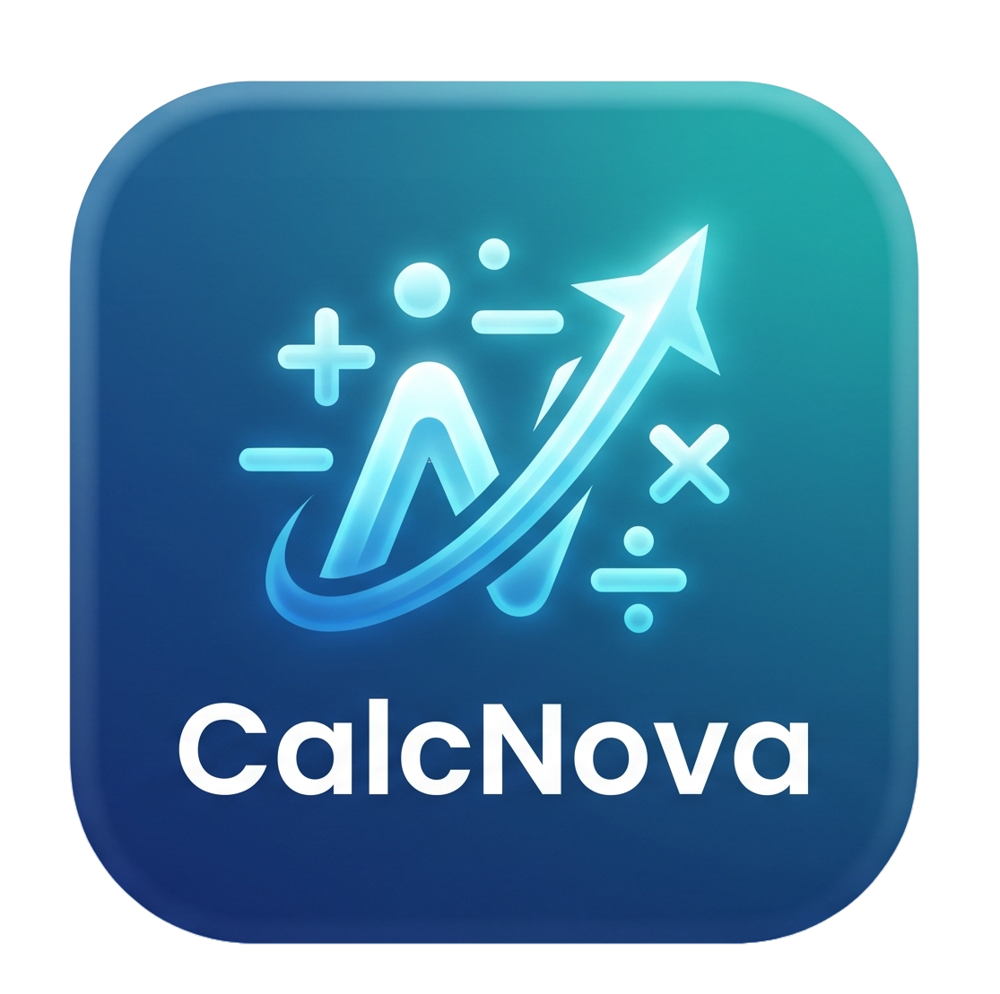
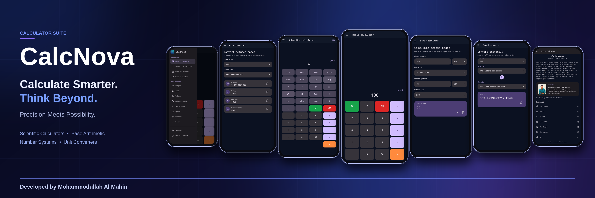
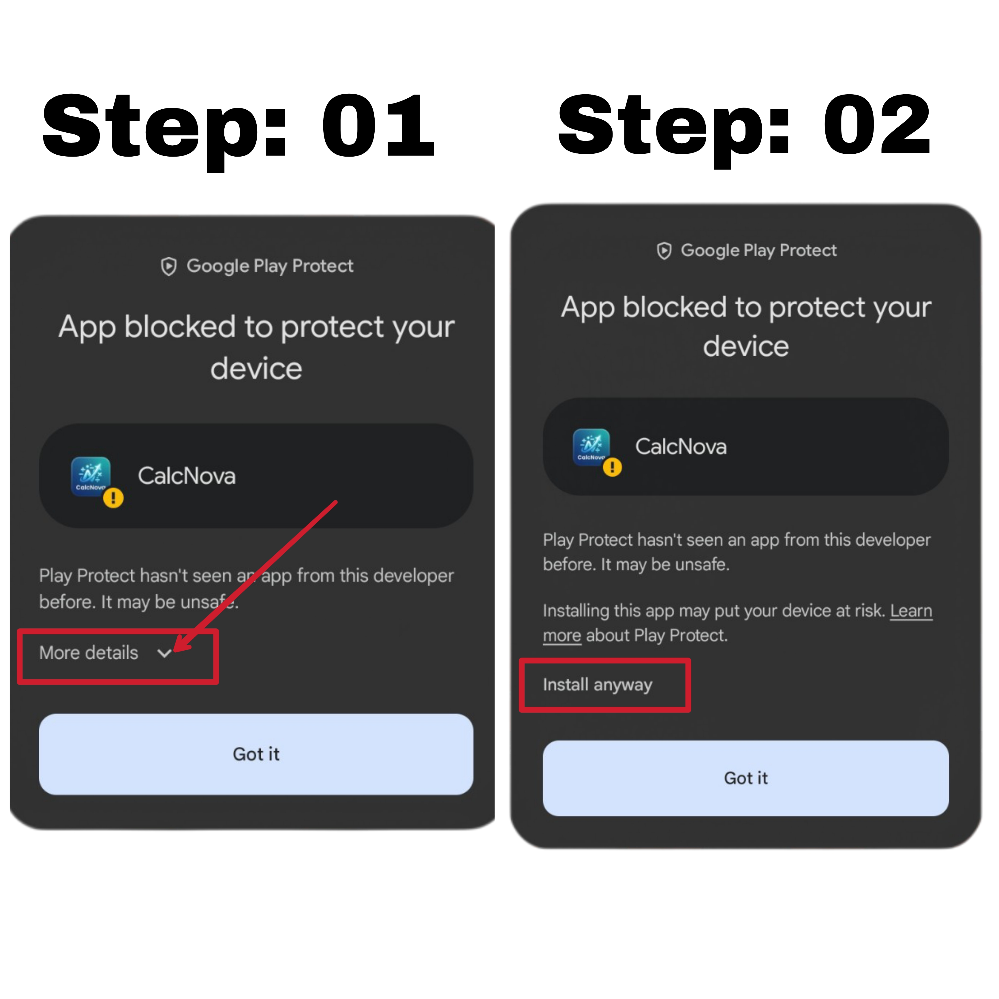

# CalcNova

<p align="center">
  
</p>

<h3 align="center">A fast, accurate, and privacy-focused calculator for everyday use.</h3>

<p align="center">
  
</p>

CalcNova is an offline-first Flutter application that combines everyday calculations,
scientific tools, number-base operations, and practical unit conversions in one
lightweight interface. It is designed for reliable results, clear controls, and a
consistent experience across Android and Linux.

## Features

### Calculators

- **Basic calculator** — operator precedence, percentages, decimals, repeated
  calculations, clear, backspace, and sign controls.
- **Scientific calculator** — trigonometric functions, logarithms, powers, roots,
  factorials, constants, and degree/radian modes.
- **Base calculator** — addition, subtraction, multiplication, and division across
  binary, octal, decimal, and hexadecimal values.

### Converters

- **Base converter** — converts binary, octal, decimal, and hexadecimal values,
  including fractional and negative values.
- **Unit converters** — length, area, volume, mass, temperature, speed, pressure,
  and power.
- **Fraction-aware base arithmetic** — parses fractional digits according to the
  selected radix rather than treating them as decimal fractions.

### Experience

- Dark, light, and system theme options.
- Responsive layouts for phones, tablets, portrait, and landscape orientations.
- Clear validation messages, copy actions, and reset controls.
- Accessible controls, consistent typography, and animated mode transitions.
- No account, database, analytics, advertising, or calculation backend.

## Download

Download the latest CalcNova release APK:

[**Download CalcNova v1.0.0**](https://github.com/mahinexe/CalcNova/releases/latest/download/calcnova_v1.0.0.apk)

Android may require permission to install an APK downloaded outside Google Play.
Only enable installation from a source you trust.

## Installation

1. Download the APK from the official release link.
2. Open the downloaded APK and review the Google Play Protect warning, if shown.
3. Tap **More details**, then tap **Install anyway**.

<p align="center">
  
</p>

## Requirements

- Flutter 3.47.7 or a compatible stable release
- Dart 3.13.5 or a compatible SDK
- Android SDK for Android builds
- Linux GTK development dependencies for Linux desktop builds

## Run locally

```bash
flutter pub get
flutter run
```

To run the Linux desktop build:

```bash
flutter run -d linux
```

## Test and build

Run the analyzer and test suite:

```bash
flutter analyze
flutter test
```

Build standard release artifacts:

```bash
flutter build apk --release
flutter build linux --release
```

### Build a versioned APK

Use the included script to build and name the release APK from the version in
`pubspec.yaml`:

```bash
./scripts/build_apk.sh
```

The verified APK is written to:

```text
build/releases/calcnova_v<version>.apk
```

For example, with:

```yaml
version: 1.0.0+1
```

- **App version:** `1.0.0`
- **Android build number:** `1`
- **APK filename:** `calcnova_v1.0.0.apk`

The script uses only the version before the `+` separator, so future version
changes do not require script changes. Repeating fractional results are
truncated to 16 fractional digits and marked with `…`.

The standard Android release output is generated under
`build/app/outputs/flutter-apk/`. The Linux bundle is generated under
`build/linux/x64/release/bundle/`. Configure release signing before publishing
to Google Play.

## Project structure

```text
lib/
├── core/
│   ├── theme/
│   └── utils/
├── features/
│   ├── about/
│   ├── basic_calculator/
│   ├── base_numbers/
│   ├── converters/
│   ├── scientific_calculator/
│   ├── settings/
│   └── shared/
├── app.dart
└── main.dart
```

## Privacy

Calculations, conversions, feedback preferences, and theme settings run locally
on the device. Internet access is used only when a user deliberately opens an
external link from the About page.

## Author

CalcNova is developed by
[Mohammodullah Al Mahin](https://github.com/mahinexe).
