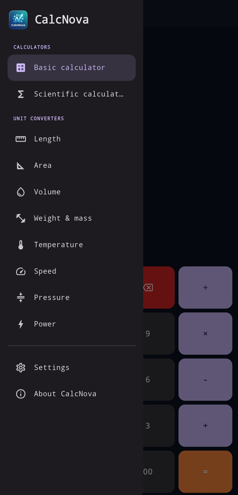

# CalcNova



CalcNova is a polished, offline-first Flutter calculator for Android and Linux. It combines a fast everyday calculator with a scientific calculator, unit conversion tools, theme preferences, and a branded About experience.

## Highlights

- Basic calculator with operator precedence, percentages, decimals, repeated calculations, clear, and backspace.
- Scientific calculator with trigonometric functions, logarithms, powers, roots, factorials, constants, and degree/radian support.
- Offline converters for length, area, volume, mass, temperature, speed, pressure, and power.
- Dark, light, and system theme options.
- Responsive layouts for phones, tablets, portrait, and landscape orientations.
- Local preferences with no account, database, analytics, advertising, or calculation backend.
- Consistent typography, animated mode transitions, accessible controls, and responsive touch targets.

## Download

Download the latest release APK:

[Download CalcNova v0.0.01](https://github.com/mahinexe/CalcNova/releases/latest/download/calcnova_v0.0.01.apk)

Android may require permission to install an APK downloaded outside Google Play. Enable installation from the relevant source only when you trust the APK.

## Requirements

- Flutter 3.47.7 or a compatible stable release
- Dart 3.13.5 or compatible SDK
- Android SDK for Android builds
- Linux GTK development dependencies for Linux desktop builds

## Run locally

```bash
flutter pub get
flutter run
```

To run the Linux desktop build:

```bash
flutter run -d linux
```

## Validate and build

```bash
flutter analyze
flutter test
flutter build apk --release
flutter build linux --release
```

The Android release output is generated under `build/app/outputs/flutter-apk/`. The Linux bundle is generated under `build/linux/x64/release/bundle/`. Configure release signing before publishing to Google Play.

## Project structure

```text
lib/
├── core/
│   ├── theme/
│   └── utils/
├── features/
│   ├── about/
│   ├── basic_calculator/
│   ├── converters/
│   ├── scientific_calculator/
│   ├── settings/
│   └── shared/
├── app.dart
└── main.dart
```

## Privacy

Calculations, conversions, and preferences run locally on the device. Internet access is used only when a user deliberately opens an external link from the About page.
